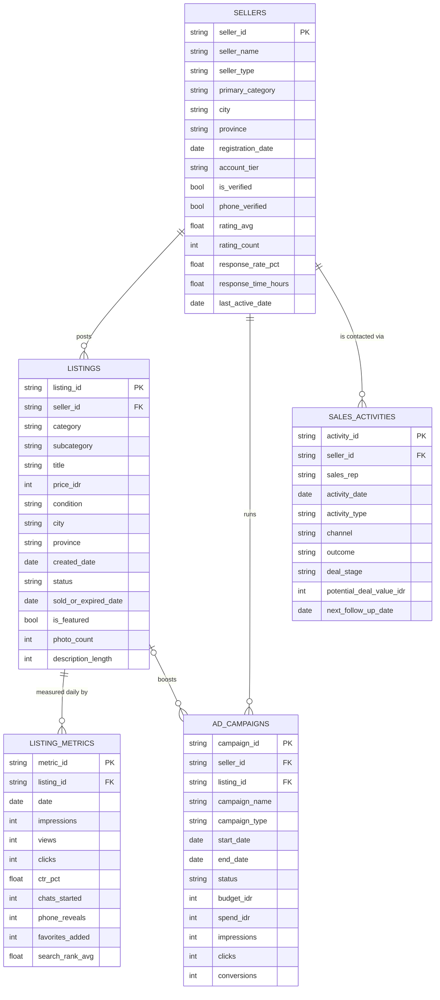

# OLX Ads Intelligence — Data Model

A sales-intelligence platform for the Ads Sales team: identify high-potential
advertisers on the marketplace, explain *why* they're an opportunity, and
recommend who to prioritize.

## The four pillars → five tables

| Pillar | Question it answers | Table(s) |
|---|---|---|
| **Marketplace** | What's being listed, where, and how is it performing? | `listings`, `listing_metrics` |
| **Seller** | Who is behind the listings — how big, how trustworthy, how active? | `sellers` |
| **Advertising** | Who is already paying to boost visibility, and how well is it working? | `ad_campaigns` |
| **Opportunity** | Who has the sales team talked to, and what's the state of that relationship? | `sales_activities` |

The **opportunity score** itself (e.g. "high organic traction, zero ad spend,
never contacted") is a *derived* metric computed by joining across all five
tables — it is intentionally not stored as a column anywhere, so the scoring
logic stays reproducible and adjustable rather than baked into the data.

## Entity-relationship diagram

## Table dictionary

### 1. `sellers` — one row per seller account
| Column | Type | Notes |
|---|---|---|
| seller_id | string PK | `SEL-000001` |
| seller_name | string | individual name or business name |
| seller_type | enum | `individual`, `small_business`, `dealer`, `enterprise` |
| primary_category | enum | dominant listing category for this seller |
| city / province | string | Indonesian geography |
| registration_date | date | account creation |
| account_tier | enum | `free`, `basic`, `premium` — current subscription plan |
| is_verified | bool | KYC/identity verified |
| phone_verified | bool | |
| rating_avg | float 1–5 | buyer-given rating |
| rating_count | int | |
| response_rate_pct | float | % of chats responded to |
| response_time_hours | float | median first-response time |
| last_active_date | date | last login/listing activity |

> "Power seller" is intentionally **not** a stored column. It is fully derivable
> (active listing count ≥ 20), and a stored snapshot flag would drift out of sync
> with `listings`. It is computed in the scoring layer instead.

### 2. `listings` — one row per posted ad
| Column | Type | Notes |
|---|---|---|
| listing_id | string PK | `LST-000001` |
| seller_id | string FK → sellers | |
| category / subcategory | enum | Vehicles, Property, Electronics, Fashion, Home & Furniture, Jobs, Hobbies & Sports, Baby & Kids, Services |
| title | string | generated per category |
| price_idr | int | category-appropriate range |
| condition | enum | `new`, `used` |
| city / province | string | usually matches seller, occasionally differs (dealers cross-list) |
| created_date | date | |
| status | enum | `active`, `sold`, `expired`, `removed` |
| sold_or_expired_date | date, nullable | terminal date if not active |
| is_featured | bool | organically featured vs paid (paid tracked in `ad_campaigns`) |
| photo_count | int | 0–12 |
| description_length | int | characters |

### 3. `listing_metrics` — daily performance fact table (grain: listing × day)
| Column | Type | Notes |
|---|---|---|
| metric_id | string PK | |
| listing_id | string FK → listings | |
| date | date | one row per active day of the listing's life |
| impressions | int | times shown in search/browse |
| views | int | ≤ impressions |
| clicks | int | contact-intent clicks (chat/phone button) |
| ctr_pct | float | clicks / views |
| chats_started | int | |
| phone_reveals | int | |
| favorites_added | int | |
| search_rank_avg | float | avg position in search results that day (lower = better) |

### 4. `ad_campaigns` — paid promotion a seller has purchased
| Column | Type | Notes |
|---|---|---|
| campaign_id | string PK | |
| seller_id | string FK → sellers | |
| listing_id | string FK → listings, nullable | null for account-level campaigns (e.g. homepage banner) |
| campaign_name | string | |
| campaign_type | enum | `featured_listing`, `bump_up`, `search_boost`, `homepage_banner`, `category_spotlight` |
| start_date / end_date | date | |
| status | enum | `active`, `completed`, `paused` |
| budget_idr / spend_idr | int | spend ≤ budget |
| impressions / clicks / conversions | int | campaign-attributed performance |

### 5. `sales_activities` — Ads Sales team's outreach log per seller
| Column | Type | Notes |
|---|---|---|
| activity_id | string PK | |
| seller_id | string FK → sellers | |
| sales_rep | string | one of a fixed rep roster |
| activity_date | date | |
| activity_type | enum | `cold_call`, `email`, `meeting`, `demo`, `proposal_sent`, `follow_up`, `renewal_call` |
| channel | enum | `phone`, `email`, `in_person`, `video_call` |
| outcome | enum | `interested`, `not_interested`, `converted`, `no_response`, `follow_up_scheduled` |
| deal_stage | enum | `prospecting`, `qualified`, `proposal`, `negotiation`, `closed_won`, `closed_lost` |
| potential_deal_value_idr | int | estimated ad-spend value of the opportunity |
| next_follow_up_date | date, nullable | |

## Design choices that matter for the "opportunity" narrative

- ~37% of sellers ever run an `ad_campaigns` row — the rest are the
  addressable market.
- Traction (`listing_metrics` views/clicks) is generated independently of ad
  spend, so some sellers end up organically high-performing *without* ever
  having advertised — these are the prime leads.
- `sales_activities` coverage is deliberately incomplete: many high-traction,
  non-advertising sellers have **zero** rows in `sales_activities`, i.e.
  the sales team hasn't reached them yet — the gap the platform should surface.
- Every foreign key is guaranteed to resolve (no orphan rows); table sizes
  and per-seller listing counts follow a skewed (power-law-ish) distribution
  to mimic a real marketplace.

## Data quality & leakage audit

Before building the opportunity-scoring layer on top of this data, the
generator was audited for **leakage** (a feature computed directly from the
thing the model is meant to predict) and **overly deterministic
relationships** (an outcome that's a closed-form formula on a handful of
stored columns, leaving nothing for a model to discover). `scripts/audit_data.py`
runs these checks against any generated dataset; run it after any regeneration.

**What was found and fixed** (first-pass generator → current):

| Issue | First pass | Fix |
|---|---|---|
| `listing_metrics` traction was a deterministic product of `category × featured × photos × tier × rating` with only mild noise | R² of traction on those columns was near 1.0 | Added a latent, unobserved per-listing quality draw (lognormal), a category×province competition/saturation dampener, category-specific monthly seasonality, and fatter-tailed daily noise. Tier/rating weights were also reduced — they still matter, but no longer dominate. |
| `is_advertiser` was a 3-value lookup on `account_tier` alone | Every free-tier seller had exactly an 8% ad rate, every premium seller exactly 75% — no other column carried any signal | Replaced with a noisy logistic function of tier, category affinity, seller type, tenure, and a latent "hustle" trait, plus substantial Gaussian noise on the logit. Tier still dominates, but the relationship is now a soft gradient, not a lookup table. |
| **`sales_activities` contact probability was computed directly from the precomputed traction sum** (`0.15 + 0.25 * traction_percentile`) | The target concept of the whole platform (organic traction) was used verbatim to generate a feature (sales coverage) — a direct label leak. An "opportunity model" trained on this would just rediscover its own generating formula. | Rewritten to depend only on signals a sales rep would plausibly have (account tier, seller type, listing *count* as a coarse/noisy size proxy, tenure, a random per-seller "territory in rotation this quarter" flag, and whether the seller already advertises) — **never** the true traction number. Any correlation between contact and real traction is now indirect, via tier/type/size. |
| `ad_campaigns` performance was a fixed linear chain off `spend_idr` with narrow noise | No diminishing returns, no campaign-level luck, no category economics | Added a campaign-level latent "creative quality" draw, category-specific CPM/CTR baselines, monthly seasonality, and a sub-linear (spend^0.9) response curve so marginal impressions per rupiah fall off at higher budgets. |

**Audit results on the current dataset** (`python scripts/audit_data.py`):

| Check | Result | Reading |
|---|---|---|
| R² of `log(total_views)` on category/featured/photos/condition/tier/rating/type | **0.10** | Stored features explain some but not most of the variance — the rest is latent quality, competition, and timing, as it would be in real marketplace data. |
| Ad rate by tier (free / basic / premium) | **16% / 68% / 83%** | Monotonic, as expected, but no 0% or 100% cell — tier is a strong predictor, not a hard rule. |
| Correlation(true traction, was\_contacted) | **0.28** | Weak-to-moderate. Sales coverage tracks account size/tier, which only loosely tracks organic performance — exactly the gap an opportunity model should find. |
| Top-quartile-traction sellers with zero ads and zero sales contact | **74 sellers (4.9%)** | The opportunity segment survived the fix — it's just no longer hand-placed there by the generator. |
| Elasticity of campaign impressions w.r.t. spend (log-log slope) | **0.91** | Sub-linear — diminishing returns on ad spend, not a flat rate. |

Re-run `python scripts/audit_data.py` after any change to the generator; a
result outside these ranges (especially check #1 creeping toward 1.0, or
check #3 rising much above ~0.5) means a leak or an overly clean formula has
crept back in.
